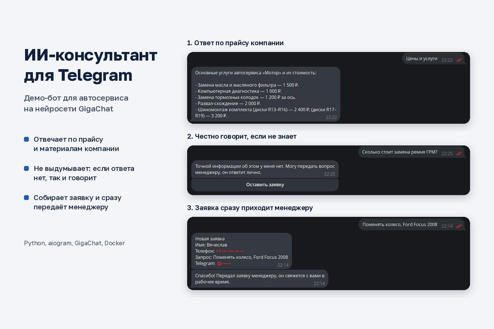

# ИИ-консультант для Telegram

Бот для небольшого бизнеса: отвечает клиентам по материалам компании (прайс, сроки, адрес) и собирает заявки для менеджера. В демо это автосервис, но вся «предметка» лежит в одном файле `knowledge.md`, так что бот переделывается под салон, клинику или магазин заменой текста.



## Что умеет

- Отвечает своими словами, но строго по `knowledge.md`. Если ответа там нет, честно говорит об этом и предлагает связаться с менеджером, а не выдумывает цены.
- Пошагово собирает заявку: имя, телефон (кнопкой «Поделиться контактом» или текстом, с проверкой формата) и что нужно. Готовая заявка уходит менеджеру в Telegram.
- Ведёт журнал вопросов и ответов в CSV: видно, о чём спрашивают чаще всего и где бот не справился.
- Работает с GigaChat или любым OpenAI-совместимым API (YandexGPT, OpenAI). Есть режим без нейросети для проверки логики.

## Запуск

```
pip install -r requirements.txt
cp .env.example .env      # впишите токен бота и ключ нейросети
python bot.py
```

Имя модели GigaChat можно узнать командой `python check_models.py`. Если поле оставить пустым, бот возьмёт первую доступную по ключу модель.

На сервере удобнее через Docker: `docker compose up -d --build`. Контейнер перезапускается сам, журнал диалогов сохраняется в папке `logs`.

## Тесты

```
pip install pytest
pytest
```

Тест прогоняет диалог целиком без сети: вопрос, заявку, проверку телефона и отправку менеджеру.

## Стек

Python, aiogram 3, GigaChat SDK, Docker.
